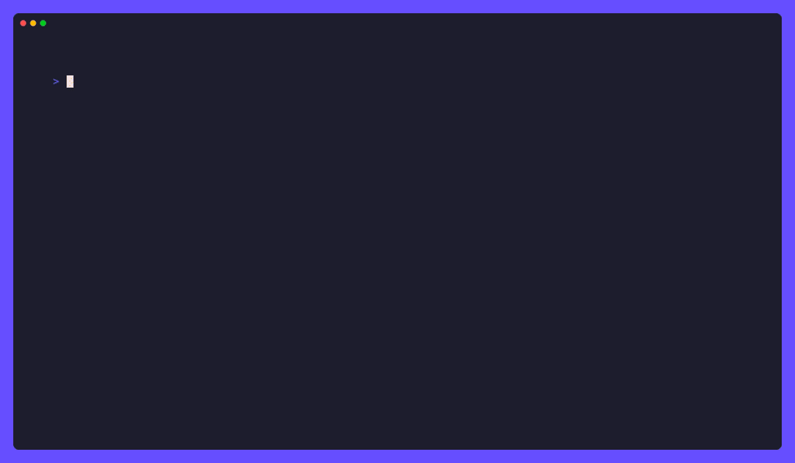
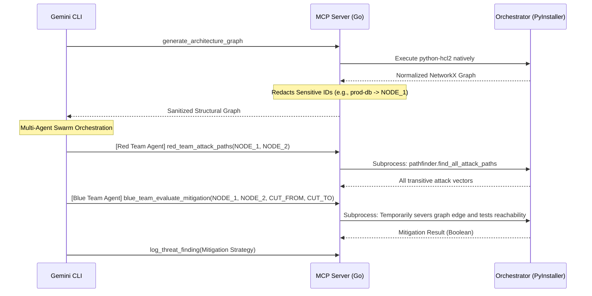

<div align="center">

# 🛡️ Threat-Sim (MCP)

**Agentic, Privacy-Preserving Threat Modeling for Infrastructure as Code**

[](https://golang.org/)
[](https://python.org/)
[](LICENSE)
[](http://makeapullrequest.com)

*A local Model Context Protocol (MCP) server that empowers Gemini to hunt for complex architectural vulnerabilities in your Terraform—without ever sending raw configurations or sensitive internal IDs to the cloud.*

[Installation](#%EF%B8%8F-installation--setup) •
[How It Works](#-architecture--privacy-model) •
[Usage](#-usage--testing) •
[Security Philosophy](#-security-model)

</div>

---

## 🚀 Why Threat-Sim?

Threat-Sim bridges the gap between **deterministic IaC scanners** and **probabilistic LLMs**.  
While static scanners are great at finding basic misconfigurations (e.g., "port 22 is open"), they struggle to piece together complex, multi-hop attack paths. LLMs excel at this lateral reasoning but shouldn't be fed raw, sensitive infrastructure context. 

Threat-Sim gives you the best of both worlds by executing parsers locally, sanitizing the resulting architectural graph, and enabling Gemini to perform full STRIDE threat models automatically.

### ✨ Key Features

- **Zero Data Exfiltration**: Never leak proprietary configurations. All sensitive entities (hostnames, IP addresses, tags) are mathematically redacted into generic markers (e.g., `NODE_0`) before hitting the LLM.
- **Agentic Analysis**: Move beyond linear checks. Let the AI agent simulate SSRF attacks, pivot across security groups, and discover shadow-admin privilege escalations.
- **Deterministic Accuracy**: Uses enterprise-grade local parsers (like Checkov) to build a mathematically accurate graph topology. The AI only reasons over the logic, not the parsing.
- **Provider Agnostic**: Out-of-the-box support for complex attack chains across AWS, GCP, and Azure.

---

## 🎥 Demo

<div align="center">
  
</div>

---

## 🧠 Architecture & Privacy Model

Parsing IaC into a graph is a solved mathematical problem. We rely on industry-standard local parsers to build the graph with 100% accuracy, reserving the LLM strictly for what it excels at: high-level security reasoning.



---

## 🔒 Security Model

Threat-Sim treats all LLM-provided parameters as untrusted input. The Go MCP server acts as an unbypassable policy enforcement point:

* **Path Containment** — Validates `target_dir` to reject absolute paths and directory traversal (`..`), preventing arbitrary filesystem reads.
* **Scanner Allowlisting** — Strict execution limits; only explicitly approved scanner names (e.g., Checkov) can be invoked.
* **Full-Payload Privacy Scrubbing** — Redacts all string attributes across graph nodes (file paths, bucket names, tags), not just IDs.
* **Resource Guardrails** — Subprocesses are killed after 120s to prevent DoS via resource exhaustion.
* **Restrictive Permissions** — De-sanitized local reports are generated with secure `0600` permissions.

---

## 🛠️ Installation & Setup

### Prerequisites
* **Checkov:** Must be installed on your host system (`pip install checkov` or `brew install checkov`).
* **Gemini CLI:** v0.26.0+
* **Go 1.22+ & Python 3.11+** *(Only if building from source)*

### 1️⃣ Build from Source
Threat-Sim packages its Python graph dependencies into a standalone binary using PyInstaller. You won't need to manage virtual environments.

```bash
git clone https://github.com/your-username/threat-sim-mcp.git
cd threat-sim-mcp
make build
```
*(This will generate `bin/threat-sim` and `bin/orchestrator`)*

### 2️⃣ Install the Extension
Install it directly into your Gemini CLI context:

```bash
gemini extension install ./
```

---

## 🕹️ Usage & Testing

Threat-Sim comes loaded with adversarial intentionally vulnerable IaC labs to test its capabilities:

1. **`examples/vulnerable-aws`**: Standard public exposure (highly permissive security groups + public buckets).
2. **`examples/complex-lateral-movement`**: Simulates an SSRF -> IMDSv1 context theft chain hopping horizontally into an internal Data Lake.
3. **`examples/privilege-escalation`**: A shadow-admin vector leveraging an exposed Lambda with unchecked `iam:PassRole`.
4. **`examples/vulnerable-gcp`**: Privilege escalation via an unauthenticated Google Cloud Function to Project Editor.

**Kick off an investigation:**

```bash
gemini --mcp threat-sim "Generate an architecture graph for the IaC in ./examples/complex-lateral-movement using checkov. If an attacker breaches the internet-facing ALB and performs an SSRF attack against the web server, map the exact access paths they can exploit to exfiltrate the 'internal-financial-records-2026' bucket. Log these findings."
```

---

## 🤝 Contributing & Development

We welcome PRs for new parsers, better sanitization heuristics, and extended agentic tools!

* `/cmd/mcp-server`: Main Go entry point serving standard MCP JSON-RPC.
* `/pkg/sanitizer`: Highly performant `sync.RWMutex` bidirectional redaction.
* `/python/orchestrator`: Wrapper for external tools yielding NetworkX graphs.

Run tests:
```bash
go test ./pkg/...
python3 -m unittest discover -s tests
```

---

<br>

<div align="center">

> ⚡ **Built with Google Antigravity**  
> *This project was built from concept to launch in a fraction of standard development time using Antigravity, demonstrating how AI accelerates complex security engineering workflows without sacrificing foundational security principles.*

</div>