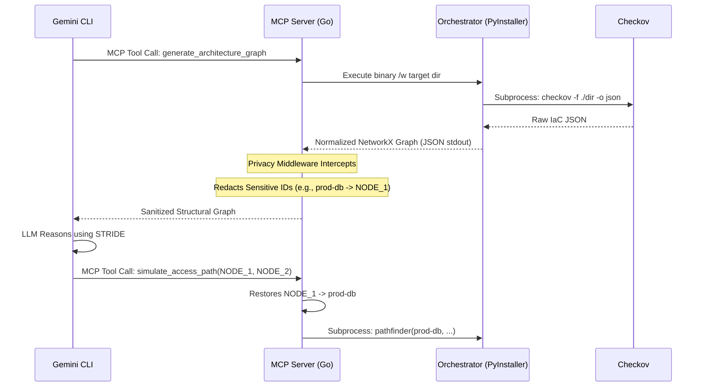

# Gemini CLI Extension: Threat-Sim (MCP)

Threat-Sim is a local, privacy-preserving Model Context Protocol (MCP) server for the Gemini CLI. It enables developers and security engineers to perform dynamic, interactive threat modeling against Infrastructure as Code (IaC) directly from the terminal. 

It leverages established DevSecOps tools for parsing and analysis, ensuring accurate architectural representation without exposing sensitive configurations to public LLM endpoints.

---

## 🚀 What It Does

Threat-Sim bridges the gap between deterministic IaC scanners and probabilistic LLMs. 
When invoked, it wraps tools like **Checkov** to parse your infrastructure files into a mathematical graph (nodes and edges). Before handing this context to the Gemini model, Threat-Sim intercepts the payload and redacts all sensitive identifiers (like internal hostnames or IP addresses), replacing them with generic markers (e.g., `NODE_0`).

Gemini then dynamically reasons over this topology to test STRIDE vulnerabilities, simulate lateral movement attacks across security groups, and log confirmed findings directly into a local `.threatmodel.json` tracking file.

### Architecture Overview



---

## 🛡️ Design Philosophy

1. **Strict Data Privacy (Zero Exfiltration):** Enterprise environments cannot send raw proprietary configurations, hardcoded internal IPs, or IAM structures to cloud APIs. By parsing locally and passing the graph through our Go middleware, Threat-Sim redacts sensitive entities.
2. **Deterministic Accuracy:** Parsing IaC into a graph is a solved mathematical problem. We rely on industry-standard local parsers to build the graph with 100% accuracy, reserving the LLM strictly for what it excels at: high-level security reasoning.
3. **Performance and Cost:** Distilling massive IaC repositories into a strict JSON payload drastically reduces the payload sent to the LLM. 

---

## 🔒 Security Model

Threat-Sim treats all LLM-provided parameters as untrusted input. The Go MCP server enforces:

* **Path containment** — `target_dir` is validated to reject absolute paths and directory traversal sequences (`..`), preventing the LLM from scanning arbitrary filesystem locations.
* **Scanner allowlisting** — Only explicitly approved scanner names are accepted.
* **Full-payload privacy scrubbing** — All string attributes across graph nodes (file paths, bucket names, tags) are redacted before reaching the LLM, not just resource IDs.
* **Subprocess timeouts** — External processes are killed after 120 seconds to prevent resource exhaustion.
* **Error sanitization** — Detailed errors are logged locally; only generic messages are returned to the LLM.
* **Restrictive file permissions** — Output files containing de-sanitized findings are created with `0600` (owner-only).

---

## 🛠️ Installation & Setup

### Prerequisites
* **Checkov:** Must be installed globally on your machine (e.g., `pip install checkov` or `brew install checkov`).
* **Gemini CLI:** v0.26.0+
* **Go 1.22+ & Python 3.11+** (Only required if building from source)

### Building the Extension
Threat-Sim packages its Python graph dependencies into a standalone binary using PyInstaller, meaning you won't need to manage virtual environments to run it.

1. Clone the repository and build the binaries:
   ```bash
   make build
   ```
   *(This will create `bin/threat-sim` and `bin/orchestrator`)*

2. Install the extension using the Gemini CLI:
   ```bash
   gemini extension install ./
   ```

---

## 🕹️ Usage & Testing

Threat-Sim thrives on discovering complex architectural vulnerabilities that basic linear logic fails to pinpoint. We've included several adversarial scenarios inside `examples/` for you to test the agent on:

1. **`examples/vulnerable-aws`**: A standard public exposure test containing highly permissive security groups and public bucket leakage.
2. **`examples/complex-lateral-movement`**: Simulates an SSRF -> IMDSv1 context theft chain where a compromised web server leverages an overly permissive IAM role to hop horizontally into a heavily locked-down internal S3 Data Lake.
3. **`examples/privilege-escalation`**: A shadow-admin vector simulating a publicly exposed Lambda URL that possesses unchecked `iam:PassRole` abilities pointing to `ec2:RunInstances`.
4. **`examples/vulnerable-gcp`**: Demonstrates provider agnosticism by simulating a GCP Project Editor privilege escalation via a public unauthenticated Google Cloud Function.

Run the following command to kick off an interactive investigation into the lateral movement chain:
```bash
gemini --mcp threat-sim "Generate an architecture graph for the IaC in ./examples/complex-lateral-movement using checkov. If an attacker breaches the internet-facing ALB and performs an SSRF attack against the web server, map the exact access paths they can exploit to exfiltrate the 'internal-financial-records-2026' bucket. Log these findings."
```

---

## 🏗️ Development

Threat-Sim utilizes a layered architecture:
* `/cmd/mcp-server`: Main Go entry point handling the MCP standard I/O protocol loops.
* `/pkg/sanitizer`: Highly performant `sync.RWMutex` bidirectional redaction maps.
* `/python/orchestrator`: Wrapper for external CLI tools yielding unified NetworkX data structures.

Run the test suite:
```bash
go test ./pkg/...
python3 -m unittest discover -s tests
```

---

> ⚡ **Built with Google Antigravity**
> *This project was built from concept to launch in a fraction of the standard wall-to-wall development time using Google Antigravity. It concretely demonstrates how AI accelerates complex security engineering and integration work without sacrificing architectural quality.*